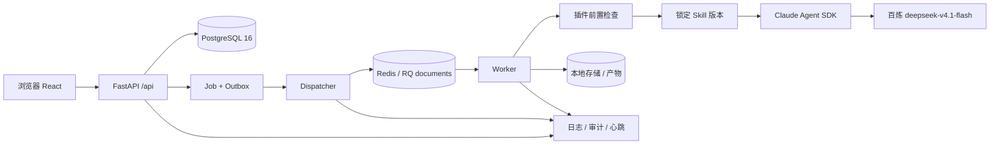

# Thesis Doc Suite 项目介绍

> 面向本科毕业设计的文书整理、生成、校验与审阅工作台。  
> 把项目资料整理成规范、可审阅、可追溯的文书拟稿。

- 文档版本：2026-11-09
- 项目仓库：https://github.com/thesis-doc-team/Thesis-Doc-Suite
- 当前工程：`thesis-doc-web`（唯一正式工程）
- 当前数据库迁移：`0021_idea_formal_run_deleted_at`

---

## 一、项目简介

Thesis Doc Suite（毕业设计文书工作台）是一套面向本科毕业设计的文书辅助系统。学生把项目源码、任务书、需求说明、图纸、表格等资料放进一个项目工作空间，系统据此辅助生成毕业设计过程文书，并把“资料整理—事实梳理—生成拟稿—模板校验—逐页审阅—意见修订—版本留痕—下载归档”串成一条完整链路。

它不是通用 AI 写作聊天框，也不是“输入题目直接产出论文”的工具。它解决的是毕业设计过程中最琐碎、最容易反复返工的部分：资料分散、学校模板复杂、格式要求多、修改意见散落在聊天记录里、版本越改越乱、内容来源说不清。

**一句话定位：把项目资料，整理成规范、可审阅、可追溯的文书拟稿。**

**合规底线：本平台用于资料整理、结构参考、排版与规范检查，不提供学位论文代写服务。所有产出均为拟稿，必须由用户审阅、修改、确认。**

---

## 二、项目背景与问题

毕业设计不是“写一篇文档”那么简单，它是一串有先后顺序、有模板要求、有审阅意见的过程：

- 资料散落在聊天记录、网盘、桌面文件夹里，找不齐、对不上。
- 学校模板栏目多、格式细，手动调格式比写内容还费时间。
- 参考文献格式、图表编号、目录页码反复出错。
- 导师意见散落在微信、邮件、线下讨论中，改到后面不知道哪条还没改。
- 每一版都另存为“最终版”，版本关系和修改原因丢失。
- 通用 AI 生成的内容“看起来像”，但事实、数据、引用来源说不清，不敢直接用。
- 不清楚学校到底要求哪些文书、先后顺序是什么。

Thesis Doc Suite 的设计目标不是“替学生写完”，而是把重复劳动交给系统，把判断权留给学生：资料可整理、事实可追溯、格式可校验、意见可闭环、版本可回看。

---

## 三、目标用户与使用场景

### 3.1 目标用户

- **本科毕业设计学生**：尤其是计算机、软件工程、电子信息、自动化、机械等需要项目源码、实物或实验数据的专业。
- **需要提交多类过程文书的毕业年级学生**：任务书、开题报告、文献综述、中期检查、指导记录等。
- **重视格式规范与审阅留痕的学生**：希望每一版修改都有记录，避免文件版本混乱。
- **学校/学院教学管理人员（管理端）**：查看项目进度、任务状态、反馈与平台运行情况。

### 3.2 典型场景

1. **开题前**：有项目源码和任务书，但不知道开题报告怎么组织，参考文献格式总出错。
2. **项目做完后**：需要把技术实现整理成项目技术文档，再派生任务书、开题报告、文献综述等。
3. **中期检查**：整理中期进展、问题自查与后续计划。
4. **指导记录**：把与导师的阶段沟通整理成规范记录。
5. **反复修改**：导师/审阅人提出意见后，基于某一版重做，同时保留旧版本与修改原因。
6. **提交前**：逐页检查版式、图表、目录、页码，确认后下载 Word。

---

## 四、产品定位与能力边界

### 4.1 是什么

- 一个单项目工作空间：资料、文书、成果、图表素材、反馈围绕同一份毕业设计聚合。
- 一条真实可走通的文书链路：建项目 → 上传资料 → 技术文档 → 审阅 → 解锁其他文书 → 生成 → 逐页审阅 → 带意见修订 → 下载/归档。
- 一套真实模板与校验体系：五类 Word 文书走官方 DOCX 模板，模板哈希锁定，做官方结构/内容校验与逐页渲染。
- 一套可追溯的审阅与版本机制：审阅通过/不通过、意见修订、历史版本保留、任务与日志留痕。

### 4.2 不是什么

- **不是学位论文代写服务**：所有产出都是拟稿，必须由用户审阅、修改、确认。
- **不是一键生成整篇论文**：当前聚焦毕业设计过程文书；毕业论文结构参考与排版检验仍为规划中能力。
- **不是 Markdown 转 Word 的排版器**：任务书、开题报告等走真实官方 DOCX 模板，做结构/内容校验，并逐页渲染审阅。
- **不是无依据的内容生成**：项目技术文档与部分文书链路强调事实、证据与参考文献可追溯；但最终仍需用户核对真实性。
- **不会运行用户上传的源码**：对上传资料做静态分析与整理，不执行源码、不安装依赖、不运行构建脚本。

---

## 五、核心功能

### 5.1 当前可用（真实实现）

| 模块 | 能力 |
|---|---|
| 游客首页 | 产品介绍、作者说明、登录/注册、可用文书状态、平台用途说明 |
| 账号与安全 | 注册/登录、HttpOnly 会话、CSRF/Origin 校验、登录限速、租户隔离 |
| 单项目工作台 | 一个项目绑定、资料/文书/成果/反馈聚合、最近动态、待办、版本概览 |
| 项目资料 | 上传源码压缩包、任务书、需求说明等；静态分析，不执行源码 |
| 项目技术文档 | 读取资料，生成技术 Markdown/HTML、图表与项目事实台账 |
| 五类 Word 文书 | 毕业设计任务书、开题报告、文献综述、中期检查记录表、毕业设计指导记录；真实 DOCX、官方模板、官方校验、逐页渲染 |
| 逐页审阅 | 页预览、通过/不通过、意见、阅读进度 |
| 修订与版本 | 基于某版重做、旧版保留、版本对比、查看/下载 |
| 成果与审阅 | 按类型归档、历史版本、格式标签、预览、下载 |
| 项目构思 | 候选题目推荐、批次管理、正式方案生成、正式方案转项目、正式方案记录软删除 |
| 图表素材库 | 项目图表、实物照片、表格模板、来源与审核状态 |
| 反馈 | 关联具体文书版本、提交反馈、查看回复 |
| 动态内容 | 首页作者说明 Markdown 阅读、后台草稿/发布/版本/图片导入 |
| 管理后台 | 总览、用户、项目、任务、模板只读、反馈、配置、监控、方案审批、内容管理、日志中心 |
| 可观测性 | 请求/任务/模型调用/审计日志、任务时间线、服务心跳 |

### 5.2 规划中（不得标为可用）

| 能力 | 状态 | 说明 |
|---|---|---|
| 毕业论文结构参考 | 规划中 | 首页合并展示为「毕业论文结构参考与排版检验」，标“规划中” |
| 毕业论文排版检验 | 规划中 | 当前不提供独立毕业论文排版检验服务 |

### 5.3 明确不做

- 学位论文代写、包过、查重规避、伪造数据/引用。
- 承诺“生成即可直接提交”；所有产出都是拟稿，需要用户审阅、核对、修改。
- 把“强调生成”包装成已生效能力：当前版本只记录强调方向，生成结果暂不读取这些选项。

---

## 六、端到端业务流程

```text
创建项目
  → 上传项目资料（源码 ZIP / 任务书 / 需求说明 / 图纸 / 表格）
  → 生成项目技术文档（事实、图表、参考资料）
  → 逐页审阅技术文档
  → 审阅通过后解锁其他文书
  → 生成任务书 / 开题报告 / 文献综述 / 中期检查 / 指导记录
  → 官方模板校验 + 逐页预览
  → 审阅通过 / 不通过并写意见
  → 基于某版重做，旧版保留
  → 下载 DOCX / HTML / Markdown
  → 版本、反馈、任务与日志留痕
```

这条链路不是概念图，而是当前系统的真实流程：技术文档完成并审阅通过后，其他文书类型才会解锁，避免在事实和参考资料尚未确认时批量派生错误内容。

---

## 七、技术架构

### 7.1 总体架构



### 7.2 技术栈

| 层 | 技术 |
|---|---|
| 前端 | React 19、TypeScript 5.7、Vite 6、React Router 7、TanStack Query 5、lucide-react、Vitest + Testing Library |
| 后端 | FastAPI 0.162、SQLAlchemy 2.1、Alembic 1.20、Pydantic 2.14、psycopg 3.3 |
| 数据库 | PostgreSQL 16 |
| 队列 | Redis 7、RQ 2.1、Job + Outbox + Dispatcher |
| 认证 | JWT HttpOnly Cookie、pwdlib 密码哈希、CSRF 双提交 + Origin/Referer、登录限速、`users.token_version` 会话吊销 |
| 模型 | Claude Agent SDK 0.2.176；默认百炼 `deepseek-v4.1-flash`，小米 MiMo `mimo-v2.6-pro` 回退 |
| Skill | 锁定发布 commit `39a076d63ccd6204c1d51cca6f91285f8bc41d68`，11 个 Skill，官方模板哈希锁定 |
| 文档 | python-docx、PyMuPDF、MS Word COM 逐页渲染（本机）、官方校验脚本 |
| 存储 | 本地 `.local/storage`；项目产物、素材、正式方案、导出文件分目录隔离 |
| 可观测性 | `log_events`、`job_attempts`、`model_calls`、JSONL 轮转、Redis 心跳、审计日志 |

### 7.3 后端关键设计

- **任务与 Outbox**：提交任务写入 Job 与 Outbox；Dispatcher 负责派发到 Redis RQ；Worker 消费并记录 attempt。
- **Worker 隔离**：Worker 只做编排与状态落库；具体生成通过锁定 Skill 脚本与 SDK 子进程完成，不使用任意 Shell。
- **模型隔离**：模型凭据只存在于子进程环境；服务端不把密钥写入提示词、响应或日志。
- **审查与版本**：产物不可变；审阅意见、修订原因、历史版本与任务关联保留。
- **可观测性**：每个请求/任务/模型调用都有 request_id/trace_id/job_id/attempt_id；管理端可查询、导出、查看任务时间线。
- **软删除**：正式方案记录支持软删除，列表隐藏但数据与产物保留，可恢复。

### 7.4 目录结构（节选）

```text
thesis-doc-web/
├─ backend/
│  ├─ app/                 FastAPI、模型、Worker、Dispatcher、可观测性
│  ├─ alembic/versions/    0001–0021 数据库迁移
│  └─ tests/               后端针对性测试
├─ frontend-next/
│  ├─ src/features/        首页、认证、工作台、构思、生成、成果、素材、反馈、管理后台、内容
│  ├─ src/shared/          API、UI 组件、错误上报
│  └─ src/styles/          设计 token 与页面样式
├─ contracts/              OpenAPI 目标契约
├─ docs/
│  ├─ rules/               研发规则（含可观测性规范）
│  ├─ templates/           任务/变更/检查清单模板
│  ├─ tasks/               任务档案
│  ├─ changes/             变更记录与 CHANGELOG
│  ├─ knowledge/           功能/API/数据/模块索引与已知问题
│  └─ features/            功能档案
├─ scripts/                本地启动、迁移、验收、检查脚本
├─ compose.yaml            PostgreSQL + Redis 本地编排
└─ AGENTS.md               研发治理入口
```

---

## 八、安全、合规与可信边界

### 8.1 安全

- **租户隔离**：项目/任务/成果按 owner 校验，普通用户不能读取他人数据。
- **会话安全**：HttpOnly Cookie、JWT 版本号、登出吊销旧会话。
- **写入保护**：非 GET 请求要求 CSRF 双提交 + 同源 Origin/Referer。
- **限速**：登录/注册按 IP 与账号限速。
- **上传边界**：源码与资料只做静态分析，不执行、不安装依赖、不运行构建脚本。
- **日志脱敏**：不记录密码、Token、Cookie、提示词、源码/正文；只记录必要元数据。
- **审计**：管理员关键操作写入审计日志，可追溯。
- **软删除**：正式方案记录等用户数据采用软删除，保留恢复能力。

### 8.2 合规

- 平台用于资料整理、结构参考、排版与规范检查，**不提供学位论文代写服务**。
- 所有产出均为拟稿，最终由用户审阅确认；不承诺“生成即可提交”。
- 不提供包过、查重规避、伪造数据/引用等能力。
- 首页、生成页、成果页、工作台等位置统一显示“拟稿”标识，避免误解为最终成稿。

### 8.3 可信边界

- 项目技术文档与部分文书链路强调事实、证据与参考文献可追溯；参考文献通过真实检索获取元数据。
- 但任何拟稿都需要用户核对真实性；系统不替用户做学术判断。
- 模型输出质量与稳定性需要持续抽样；对外展示时不得把“规划中”能力说成已上线。

---

## 九、项目现状与验证

### 9.1 当前状态（2026-11-09）

- 6 类文书可用：项目技术文档、毕业设计任务书、开题报告、文献综述、中期检查记录表、毕业设计指导记录。
- 5 类 Word 文书已打通真实 DOCX、官方模板、官方校验、逐页渲染，并于 2026-11-03 获得用户验收（任务书、开题报告、文献综述、中期检查、指导记录）。
- 项目构思/正式方案、单项目工作台、素材库、反馈、管理后台、动态内容、日志中心均已接通。
- 正式方案记录支持软删除（迁移 0021）。
- 本地模型链路已真实调用验证：智能推荐接口返回 200，7.1 秒生成 5 条补充功能（百炼 `deepseek-v4.1-flash`）。

### 9.2 测试与质量

- 前端：`npx tsc -b`、`npm run build`、`npm test -- --run` 通过；当前 10 个测试文件、81 项测试通过。
- 后端：针对性测试覆盖认证/CSRF、项目管理、工作台、正式方案、CMS、日志/可观测性等；正式方案 15 项、工作台 13 项、日志相关 58 项等。
- 数据库迁移：0001–0021 已应用；迁移前有全库备份记录。
- 治理检查：`scripts/check_governance.py`、`scripts/check_knowledge_assets.py` 通过。
- 说明：最新代码的完整“从零真实长跑”未在本次复验；具体任务证据以 `docs/tasks/` 与 `docs/changes/` 为准。

### 9.3 已知边界

- “强调生成”当前只记录选项，Worker 尚未消费（GAP-001）。
- 工程实施方案查看权限尚未在后端强制。
- `contracts/openapi.yaml` 未覆盖全部当前 `/api/*` 路由。
- Docker 完整模式未做最终验收；本机模式已验证。
- 毕业论文结构参考/排版检验为规划中。

---

## 十、本地运行

### 10.1 环境要求

- Python 3.12（项目 `.venv`）
- Node.js 24（前端 `frontend-next/`）
- Docker Desktop（PostgreSQL 16、Redis 7）
- Windows 本机；Word 逐页渲染依赖本机 MS Word COM

### 10.2 配置

复制 `.env.example` 为 `.env`，按本机环境填写：

- `POSTGRES_USER` / `POSTGRES_PASSWORD` / `POSTGRES_DB`
- `JWT_SECRET`（至少 32 字符随机串）
- `APP_ORIGIN=http://localhost:8080`
- `MODEL_PROVIDER=bailian`、`BAILIAN_MODEL`、`BAILIAN_BASE_URL`、`BAILIAN_API_KEY`
- 不要把真实密钥写入 `.env.example`、README、文档或 Git。

### 10.3 启动

```powershell
# 1. 初始化与检查
python scripts/init_local.py
python scripts/preflight.py

# 2. 启动数据库与 Redis
docker compose up -d db redis

# 3. 数据库迁移
.\.venv\Scripts\python.exe scripts/run_local.py migrate

# 4. 分别启动三个后端进程
.\.venv\Scripts\python.exe scripts/run_local.py api
.\.venv\Scripts\python.exe scripts/run_local.py dispatcher
.\.venv\Scripts\python.exe scripts/run_local.py worker

# 5. 启动前端
cd frontend-next
npm.cmd ci
npm.cmd run dev -- --host 127.0.0.1 --port 8080 --strictPort
```

访问：

- 前端：http://localhost:8080
- API 文档：http://127.0.0.1:8000/api/docs
- 健康检查：http://127.0.0.1:8000/api/health

### 10.4 登录

- 默认通过注册/登录使用真实账号。
- 本机开发可通过 `.env` 的 `DEV_LOGIN_ENABLED` 控制一键体验登录；默认关闭。
- 本地演示账号密码不写入仓库与文档，由本机管理员配置。

### 10.5 测试

```powershell
# 前端
cd frontend-next
npx tsc -b
npm run build
npm test -- --run

# 后端针对性测试
.\.venv\Scripts\python.exe -m unittest backend.tests.test_auth_hardening -v
.\.venv\Scripts\python.exe -m unittest backend.tests.test_idea_formal -v
.\.venv\Scripts\python.exe -m unittest backend.tests.test_workbench_binding -v

# 治理与知识资产
python scripts/check_governance.py
python scripts/check_knowledge_assets.py
```

---

## 十一、项目亮点

1. **不是“AI 写完”，而是“资料到拟稿”的完整链路**
   资料、技术文档、其他文书、审阅、版本、下载在同一条链路里，不是一次聊天。

2. **真实学校模板与官方校验**
   五类 Word 走官方 DOCX 模板，模板哈希锁定，保留固定栏目/表格；再做官方结构/内容校验与逐页渲染。

3. **逐页审阅与意见闭环**
   每一页可看、可提意见；意见带入下一版，旧版不覆盖。

4. **事实、证据、参考文献可追溯**
   项目技术文档沉淀事实与证据；部分文书链路通过真实检索获取参考文献元数据。

5. **全链路可观测**
   请求、任务、尝试、模型调用、审计、前端错误统一关联，管理端可检索日志与任务时间线。

6. **安全边界清晰**
   租户隔离、CSRF/Origin、上传源码不执行、日志脱敏、软删除与审计。

7. **全站“拟稿”标识**
   首页、生成、成果、工作台、进度、反馈、管理后台统一标注“拟稿”，避免把草稿误当最终稿。

---

## 十二、文档索引

| 文档 | 说明 |
|---|---|
| `AGENTS.md` | 研发治理入口、角色、流程与限制 |
| `README.md` | 本机运行、测试、当前边界 |
| `docs/DEVELOPER-HANDOVER.md` | 开发交接与当前事实覆盖说明 |
| `docs/rules/` | 研发规则、可观测性规范 |
| `docs/templates/` | 任务、变更、影响分析、可观测性检查清单 |
| `docs/tasks/` | 任务档案与实施/验证记录 |
| `docs/changes/` | 变更记录与 CHANGELOG |
| `docs/knowledge/` | 功能/API/数据/模块索引、已知问题 |
| `docs/features/` | 功能档案 |
| `contracts/openapi.yaml` | OpenAPI 目标契约（部分端点尚未同步） |

---

## 十三、后续路线

- 完成“毕业论文结构参考与排版检验”的独立能力评估与实现（当前规划中）。
- 让“强调生成”选项真正进入 Worker 生成策略（GAP-001）。
- 补齐工程实施方案的后端读取权限。
- 同步 OpenAPI 与当前 `/api/*` 路由。
- 完成 Docker 完整模式验收。
- 在最新代码上执行一次从零真实长跑，并保留完整证据。
- 继续完善移动端、无障碍与审阅体验。

---

## 十四、说明

本文档用于项目介绍与对外展示，不替代任务验收文档。涉及功能状态时，以当前源码、数据库迁移、`docs/knowledge/FEATURE-REGISTRY.md` 与真实页面为准；规划中能力不得标注为可用。

如需演示或验收，请使用本地环境与演示数据，不要上传真实学生个人信息、论文正文或未授权的项目源码。